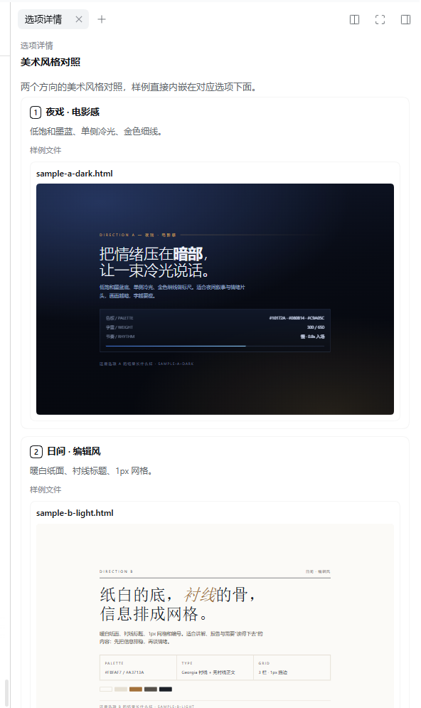

# 选项详情 · dsh-sidebar-options

给 **DeepSeek Harness** 用的右侧栏插件：我做选择时（Q&A 提问、计划审阅、工具授权），右边自动弹出「选项详情」面板，把每个选项的完整说明和它附带的样例文件（HTML / 图片 / Markdown / 文本）直接摊开 —— 不用再去文件夹里翻样例。

> A DeepSeek Harness plugin: a right-sidebar panel that shows every option of a pending question together with its sample files.



## 它怎么工作

- 数据来源是客户端统一的待处理交互源 `uiSession.sessionStatus`（`pendingInteraction`）。它同时覆盖三类"要你拍板"的卡片：`question`、`plan-review`、`approval`，一条订阅全包。
- 向官方右侧栏注册一个页面型 tab（`sidebarRightTabs.register` + `sidebarRight.openTab`），body 挂在 `sidebar.right.pane.tab`（key = 本包 id），标题挂在 `sidebar.right.pane.tab.title`。
- 出现待处理交互 → 自动开 tab 并展开右侧栏；答完（交互消失）→ 自动关 tab、收起右侧栏。
- 手动点 × 关掉时，同一张卡不会反复弹（按交互 key 记住），下一张卡才会重新弹。

## 选项的样例从哪来

**在选项的 `description` 里直接写文件路径**，插件自己抓出来渲染：

```text
夜戏 · 电影感 —— 低饱和墨蓝、单侧冷光。样例 demo/sample-a-dark.html
日间 · 编辑风 —— 暖白纸面、衬线标题。样例 demo/sample-b-light.html 和 images/cover.png
```

- 支持：工作区相对路径（`demo/x.png`、`./out/x.png`）、Windows 绝对路径（`E:\...\x.html`）、`file:///...`、Markdown 链接 `[说明](out/x.png)`。建议用相对路径，对话里的官方卡片会原样显示它。
- 渲染：图片内嵌（`remote.workspaceFiles.readBytes` → data URL，点击用官方预览打开原文件）；HTML 按**设计宽度 960px 渲染再整体缩放**进面板（禁脚本），所以看到的是作者原本的版式，而不是被挤成窄栏的重排结果；md/txt/json/csv 内嵌前 32 行；其他格式（pptx/pdf/docx…）只给文件名，点一下用官方预览打开。
- 版式：题号用 **1、2、3**；选项只显示标题 + 说明，**说明里出现的样例地址会被剥掉**（文件已经在下面按文件名列出）；文件条只显示**文件名**，不显示目录、也不加"在侧栏打开"字样 —— 点文件名或预览都能打开官方预览。
- 没写路径的选项只显示文字说明。
- **正文里的产物也会进面板**：提问前我用 `present` 交付过的文件（海报、截图、PPT…）会从会话日志里捞出来，在面板顶部「正文里的产物」里列出并预览 —— 不用在选项描述里再抄一遍路径。只取最近 6 个，且只保留 Host 还能 `stat` 到的文件（挪走或删掉的路径不显示，避免出现「预览失败」的空卡片）。
- 「选项详情」也出现在右侧栏的 Guide 页，没有待处理问题时也能手动打开。

## 覆盖范围

| 场景 | 是否覆盖 | 说明 |
|---|---|---|
| `ask_user_question` 提问 | ✅ 实测通过 | 自动开、自动关都验过 |
| 计划审阅（plan-review） | ✅ 代码路径同 `question` | 第 0 题 `intent.kind === 'plan-review'` 时展示完整计划正文 |
| 工具授权（approval） | ✅ 走 `pendingInteraction.kind === 'approval'` | 客户端只拿到 `toolName` / `reason` / `displayReason`，**没有工具参数**；只有理由文本里出现路径时才有样例 |

## 安装

**别人从 GitHub 装（推荐）**

```
plugin_manager install_bundle   target: github:Pahsin/dsh-sidebar-options
```

或在本机命令行：

```
dsh plugin add github:Pahsin/dsh-sidebar-options
```

（`install_bundle` 先对仓库做 `git ls-remote` 检查，所以机器上要有 git。）

**本地目录装（开发用）**

```
plugin_manager install_bundle   target: <本目录绝对路径>
plugin_manager remove_bundle    target: dsh-sidebar-options
```

安装后**刷新页面**（Ctrl+R）即可；改了 `client.js` 同样只要刷新，不用重启 App。无配置项、无工具、不写任何会话事件。

## 已知边界

- **用的是非官方扩展点**：`uiSession.sessionStatus`、`sidebarRightTabs`、`sidebarRight`、`remote.workspaceFiles` 都不是公开 API 文档里的稳定契约。DSH 升级后可能失效，失效时面板会静默不弹（不会弄坏宿主）。
- **HTML 是沙箱 iframe**（`sandbox=""`，禁脚本）：不跑 JS，同目录 css/图片的相对引用解析不到；要完整看就点文件名用官方预览打开。缩放后文字偏小（960 → 面板宽约 500，约 0.5 倍），看版式好用、读正文要靠点开。
- 图片走 host 读 bytes 再转 data URL，大图会慢一点。
- 一次只显示"在屏会话"当前的待处理交互；同会话多张卡时按官方优先级（计划审阅 > 提问 > 授权）只显示最高的那张。
- 右侧栏宽度由宿主控制。若你装了右下角浮层类插件（如余额气泡），可能盖住面板右下角。

## 后续可以加

1. 工具授权的工具参数（现在只有理由文本）：要读会话日志里的 `tool/call`，或者走 Host 侧通道。
2. 侧栏里直接点选提交（现在刻意只做预览，选择仍在对话里的卡片点）。
3. HTML 预览的"展开/全屏"和缩放。
4. 样例缩略图墙（现在是一条条竖排）。

实现踩到的坑见 [NOTES.md](NOTES.md)；许可证 [MIT](LICENSE)。